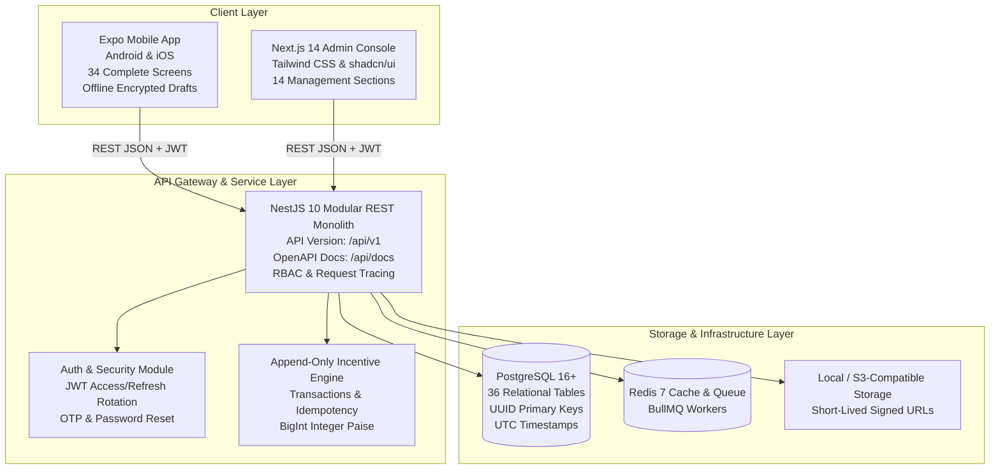

# Lumora + Cypher Swift Partner Network — System Architecture

## 1. High-Level Architectural Topology

---

## 2. Layer Responsibilities & Technical Stack

### 2.1 Mobile Application (`apps/mobile/`)
- **Framework:** React Native + Expo SDK 51, TypeScript.
- **Routing:** Expo Router v3 (file-based stack & 5 bottom tabs: Home S11, Leads S14, Meetings S19, Earnings S24, Profile S30).
- **Design Tokens:** Deep navy base (`#070F1E` / `#0B192C`), Lumora accent (`#FF6500`), Cypher Swift accent (`#003566`), Teal secondary (`#00C9FF`).
- **State & Caching:** TanStack React Query v5 (server state caching) + Zustand (client state).
- **Offline Reliability:** `useDraftStore` with MMKV encrypted local persistence ensuring no prospect or meeting notes are ever lost silently.

### 2.2 Admin Web Console (`apps/admin/`)
- **Framework:** Next.js 14 (App Router), TypeScript, Tailwind CSS.
- **Components:** Modular shadcn/ui design patterns with unified brand aesthetics.
- **Data Tables:** TanStack Table with virtualized scrolling, search, sorting, and CSV export.
- **Scope:** 14 full management sections covering Partner Management, Conflict Resolution, Deal Verification, Commission Approvals, Payout Batches, and Immutable Audit Logs.

### 2.3 Backend API (`apps/api/`)
- **Framework:** Node.js + NestJS 10 (Strict TypeScript).
- **Architecture:** 16 decoupled domain modules with dependency injection.
- **API Standards:**
  - Prefix: `/api/v1`.
  - Auto-generated Swagger OpenAPI 3.0 documentation at `/api/docs`.
  - Standard response envelope: `{ success: true, data: T, meta?: PaginationMeta, request_id: string }`.
  - BigInt Serialization: Automatic recursive interceptor converts `BigInt` paise to strings and formatted rupees.
  - Append-Only Middleware: Intercepts updates/deletes to financial ledger models and aborts with a 403 Forbidden error.

---

## 3. Financial & Business Integrity Invariants

1. **Monetary Precision:** All amounts stored strictly as `BigInt` (integer paise). Floating-point numbers are prohibited for financial calculations.
2. **Append-Only Ledger:** The `commission_ledger`, `commission_adjustments`, and `audit_events` tables reject `UPDATE` and `DELETE` queries at both the application and ORM middleware levels.
3. **Segregation of Duties:**
   - Partners cannot verify payment receipts or self-approve incentives (`approvedById !== partnerId`).
   - Sales cannot approve commissions.
   - Operations cannot execute financial disbursements.
   - Finance alone approves commissions and records bank payout batches.
4. **Idempotency Guarantee:** Every commission generation and payment evidence verification requires an idempotency key (`X-Idempotency-Key` or deterministic key `COMM_{dealId}_{triggerEvent}`) evaluated inside a serializable database transaction.
5. **Commercial Disclaimer:** The ₹37,000 (3,700,000 paise) shared business diagnostic is formally marked as configurable commercial data awaiting definitive contract execution.
