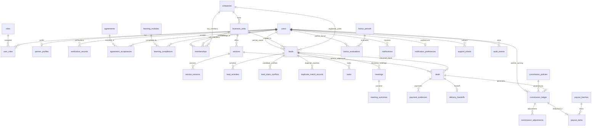

# Lumora + Cypher Swift Database Entity-Relationship Diagram

## Entity Summary by Domain

| Category | Primary Models | Key Invariants |
| :--- | :--- | :--- |
| **Identity & Access** | `users`, `roles`, `user_roles`, `partner_profiles`, `verification_records` | Unique email and phone; bcrypt cost 10+; verification tracking |
| **Agreements & Training** | `agreements`, `agreement_acceptances`, `learning_modules`, `learning_completions` | Immutable acceptance records with client IP and user-agent |
| **Organization & Scope** | `companies`, `business_units`, `memberships` | Multi-tenant organization scoping; RBAC scoped to business units |
| **Service Catalogue** | `services`, `service_versions` | Versioned content snapshots; configurable diagnostic pricing |
| **Leads & Pipeline** | `leads`, `lead_activities`, `lead_claim_conflicts`, `duplicate_match_records` | Domain and phone unique checks; strict stage machine |
| **Meetings & Tasks** | `meetings`, `meeting_outcomes`, `tasks` | Mandatory qualification recording before deal conversion |
| **Deals & Operations** | `deals`, `payment_evidences`, `delivery_handoffs` | Evidence review workflow; BigInt integer paise |
| **Financial Ledger** | `commission_policies`, `commission_ledger`, `commission_adjustments`, `payout_batches`, `payout_items`, `bonus_periods`, `bonus_evaluations` | **Append-Only**; partner self-approval blocked; idempotent |
| **Audit & Governance** | `audit_events`, `idempotency_records`, `support_tickets`, `notifications` | Append-only system audit log with actor ID and before/after diffs |
